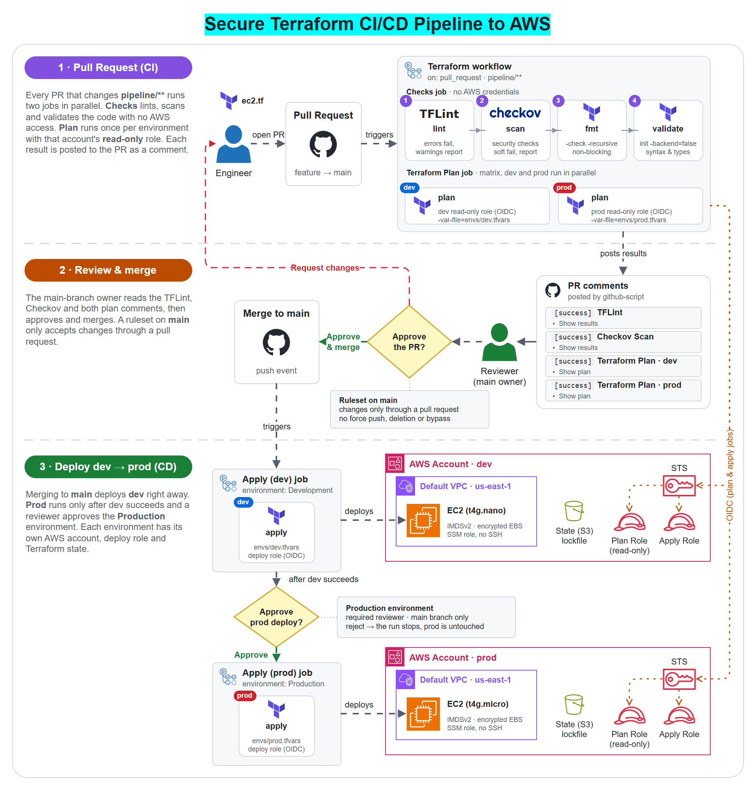

<h1 align="center">Secure CI/CD Pipeline for AWS Deployments via Terraform</h1>

  
  
  
  
  

## Overview

This project is a secure, multi-environment, multi-account CI/CD pipeline for AWS infrastructure, built with Terraform and GitHub Actions. The development and production environments live in separate AWS accounts.

Resources created by hand in the console (ClickOps) are hard to review and audit. A public S3 bucket or an unencrypted volume can go live without anyone noticing, and over time environments drift apart because nobody knows exactly what changed or when. Moving from ClickOps to an automated, versioned and repeatable setup means every change goes through code first.

When a pull request that changes `pipeline/` is opened or updated, the **Checks** job runs TFLint, Checkov, `terraform fmt` and `terraform validate`, while the **Terraform Plan** job runs `terraform plan` for dev and prod in parallel. Each result is posted to the pull request as a comment, so before any infrastructure is provisioned, a reviewer can see what will be created or changed and which resource settings are non-compliant.

Once the pull request is merged, the changes are deployed to the Development account automatically. The Production deployment then waits until a required reviewer approves it on the Production environment.

## Design Decisions

- **No long-lived credentials:** GitHub Actions authenticates to both AWS accounts through OIDC federation, so no access keys are stored in GitHub.
- **Separate roles for plan and apply in each account:** pull requests only use a read-only role, for `terraform plan` (read-only except for the state lock file, see [Prerequisites](#prerequisites)). The write role for `terraform apply` is only used by the apply jobs, which run after a merge to `main`.
- **No AWS access for static checks:** the Checks job can't request an OIDC token, so linting and scanning run without any AWS credentials.
- **Apply roles bound to GitHub environments:** each environment has its own `ARN_ROLE` secret, which GitHub only exposes to jobs that pass that environment's protection rules. Both environments accept deployments from `main` only.
- **Two gates before production:** dev is deployed as soon as the pull request is merged; prod also needs an approval on the Production environment.
- **Changes only through pull requests:** a branch ruleset on `main` requires a pull request and blocks force pushes and branch deletion, with no bypass allowed.
- **One deployment at a time:** each apply job has its own concurrency group, so two deployments to the same environment never run in parallel.
- **Checkov is advisory:** it runs in soft-fail mode, so its findings are reported on the pull request but never fail the job. TFLint errors and `terraform validate` failures do fail the Checks job.
- **Separate state per environment:** each environment keeps its Terraform state in its own S3 bucket, with S3 native state locking (`use_lockfile`).

## Pipeline Walkthrough

The workflow ([`.github/workflows/terraform.yml`](.github/workflows/terraform.yml)) runs on pull requests to `main` and on pushes to `main` (that is, merges), but only when files under `pipeline/` change. It has four jobs:

- **Checks** (pull requests only, no AWS credentials)
  - Checkout loads the repository on the runner.
  - TFLint is set up, initialized and run with the Terraform and AWS rulesets. Only `error`-severity findings count as failures.
  - GitHub Script posts the TFLint results as a pull request comment.
  - Checkov scans the pull request's code against more than 1,100 Terraform checks (over 450 of them for AWS) in soft-fail mode, so its findings never fail the job.
  - GitHub Script posts the Checkov report as a pull request comment.
  - Terraform is set up and initialized without a backend (`-backend=false`). `terraform fmt -check` runs as a non-blocking check, and `terraform validate` must pass.
  - If TFLint reported errors, the job fails at the end, after both comments have been posted.
- **Terraform Plan** (pull requests only, once per environment)
  - The job runs as a matrix for dev and prod in parallel. `fail-fast` is off, so a failure in one environment doesn't cancel the other.
  - Checkout loads the repository on the runner.
  - Configure AWS Credentials assumes the environment's read-only role through OIDC, in that environment's account only.
  - Terraform is initialized with the environment's S3 backend, and `terraform plan` runs with `envs/<env>.tfvars`.
  - GitHub Script posts the plan as a pull request comment, one per environment.
- **Apply (dev)** (pushes to `main` only)
  - Runs on the push to `main` that a merge creates. Direct pushes to `main` are blocked by the branch ruleset.
  - Checkout loads the repository on the runner.
  - Configure AWS Credentials assumes the apply (write) role in the Development account through OIDC.
  - Terraform is initialized with the dev backend, and `terraform apply` runs with `envs/dev.tfvars`.
- **Apply (prod)**
  - Starts only after Apply (dev) succeeds, then waits for a required reviewer to approve the deployment on the Production environment.
  - Checkout loads the repository on the runner.
  - Configure AWS Credentials assumes the apply (write) role in the Production account through OIDC.
  - Terraform is initialized with the prod backend, and `terraform apply` runs with `envs/prod.tfvars`.

## Infrastructure

All resources are currently commented out (decommissioned), so the pipeline applies an empty configuration and nothing is running in either account. When enabled, the Terraform code in [`pipeline/`](pipeline/) creates the following in each account's default VPC in `us-east-1`:

| Resource | File | Security settings |
|---|---|---|
| EC2 instance, Amazon Linux 2023 on arm64 (`t4g.nano` in dev, `t4g.micro` in prod) | `ec2.tf` | IMDSv2 only, encrypted root volume, access through SSM Session Manager instead of SSH (no key pair, no open ports) |
| Aurora PostgreSQL 17, Serverless v2 | `rds.tf` | Encrypted storage, master password generated and rotated by RDS in Secrets Manager, IAM database authentication, TLS required, not publicly accessible, deletion protection, 7-day backups, pauses after 30 idle minutes |
| S3 bucket for scan evidence | `s3.tf` | Public access blocked, default encryption (SSE-S3), versioning, TLS-only bucket policy, objects expire after 90 days |

Every resource is tagged with its `Environment` and `ManagedBy = Terraform` through the provider's default tags.